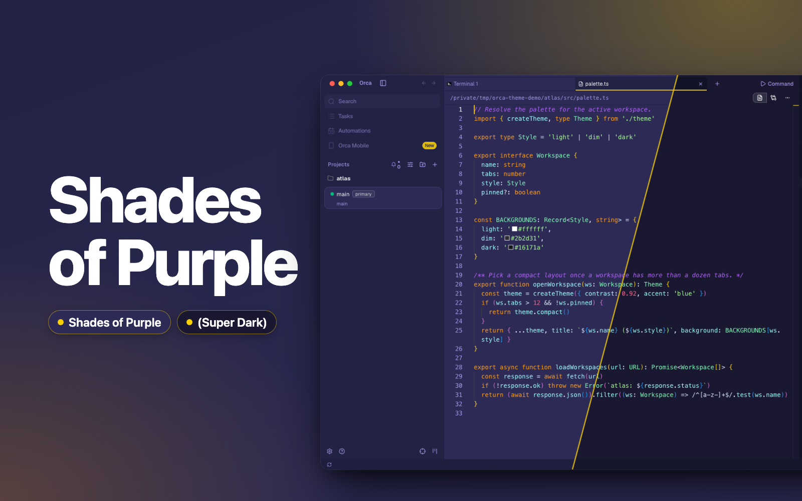
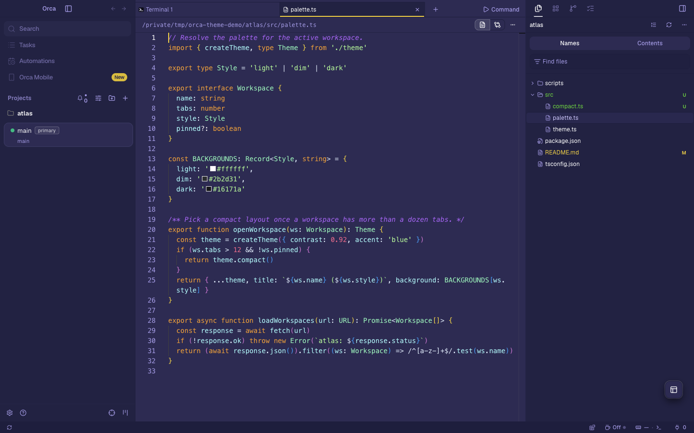
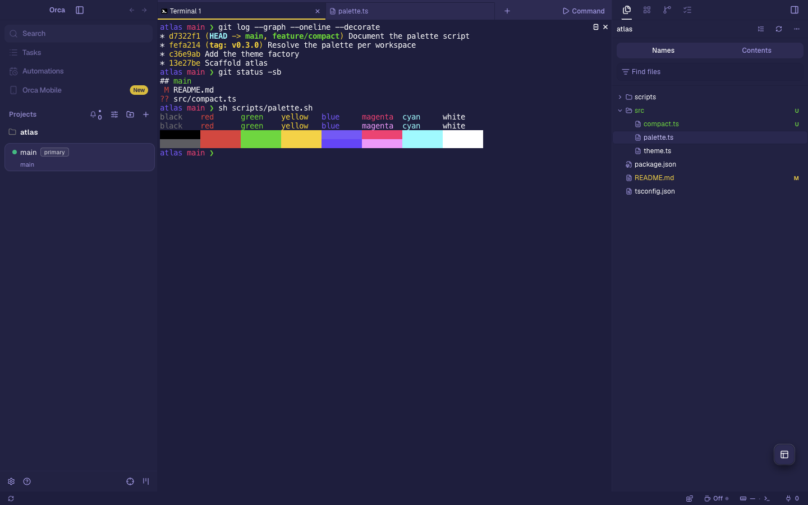
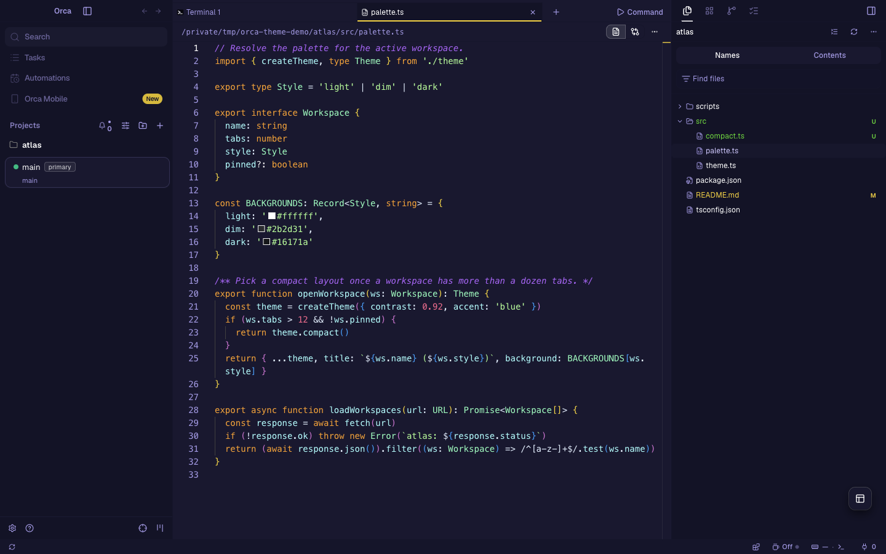
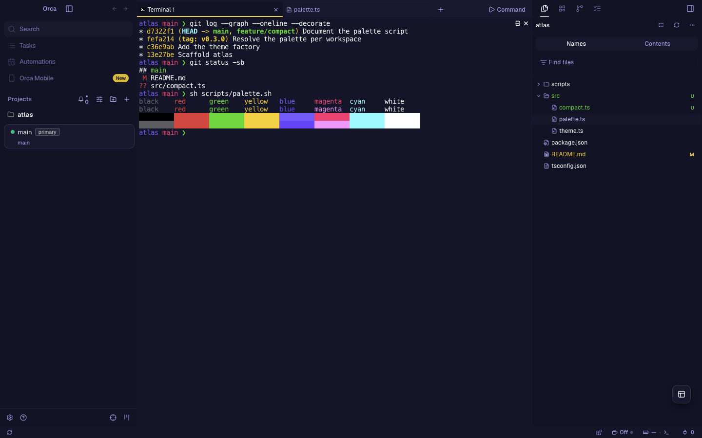

# Shades of Purple for Orca

[Shades of Purple](https://github.com/ahmadawais/shades-of-purple-vscode) and its Super Dark
style as app, editor and terminal themes for [Orca](https://github.com/stablyai/orca). It is
built from shades-of-purple-vscode commit
[`e8eb49f`](https://github.com/ahmadawais/shades-of-purple-vscode/commit/e8eb49f33e5db05ceba6677367b33ddb27ad821c)
(version 7.3.6). Shades of Purple is designed by [Ahmad Awais](https://github.com/ahmadawais).



## The themes

Both styles are dark themes with yellow `#fad000` as the accent. Each one themes the app, the
editor's syntax colors and the terminal's 16 ANSI colors.

- **Shades of Purple** is upstream's main style, on a purple `#2d2b55`.
- **Shades of Purple (Super Dark)** is the same palette on a near-black purple `#191830`.

| Style | Editor | Terminal |
| --- | --- | --- |
| Shades of Purple |  |  |
| Super Dark |  |  |

Upstream's third file, the italic theme, changes only font styles, so it is not a separate style
here. Comments, storage modifiers and attributes are italic in both styles, as upstream's main
theme has them.

## Install

Find **Shades of Purple for Orca** in Orca's plugin directory and install it. It needs Orca
1.4.246 or later. To install it from this repository instead:

1. In Orca, open Settings → Plugins.
2. Open **Add plugin** → **From a Git URL…**.
3. Enter `https://github.com/vale-c/orca-shades-of-purple.git` with ref `main`, and install
   **Shades of Purple for Orca**.
4. In Settings → Appearance, pick **Shades of Purple** or **Shades of Purple (Super Dark)** as the
   dark theme. Pick the terminal theme of the same name in the terminal settings.

To try a local copy instead, use **Add plugin** → **From a folder…** and select the root folder
of this repository. Orca reloads the theme when the files change.

## How the colors map

Upstream writes each style by hand as a VS Code theme file. `scripts/shades-of-purple-palette.json`
holds the workbench colors and token rules of both files at the pinned commit.

Each Orca token takes the VS Code color that paints the same part of the window. For example,
`--background` is `editor.background`, `--sidebar` is `sideBar.background`, `--card` is
`panel.background`, `--tab-active-indicator` is `tab.activeBorder`, and `--diff-added-background`
is `diffEditor.insertedTextBackground`. Each syntax rule takes the color and font style that VS Code
resolves for one named upstream selector. `scripts/build.mjs` lists every mapping, and
`scripts/derived-tokens.json` lists the tokens left to Orca with the reason for each.

## Differences from upstream

Orca drops an app text color under 4.5:1 contrast with its surface, and a git status color under
3:1 on the sidebar. This color is changed in OKLCH lightness only, keeping chroma and hue, by the
smallest step that passes:

| Style | Color | Used for | Upstream | Shipped |
| --- | --- | --- | --- | --- |
| Shades of Purple | `gitDecoration.ignoredResourceForeground` | Git-ignored files (2.60:1 upstream) | `#645e97` painted | `#6e69a3` |
| Super Dark | `gitDecoration.ignoredResourceForeground` | Git-ignored files (2.77:1 upstream) | `#5d5789` painted | `#635e90` |

Two colors in the main style would leave the sRGB gamut, and so shift in hue, before a lightness
change made them pass. Each takes the upstream color of a neighboring role instead:

- Links use `editorLink.activeForeground` (`#a599e9`), upstream's link color in the editor.
  Upstream's `textLink.foreground` (`#b362ff`) is 3.85:1 on the editor, under Orca's 4.5:1 for
  links. Super Dark keeps its own `textLink.foreground`, `#fad000`.
- The removed-line hue, `--diff-removed`, uses `markup.deleted` (`#f16e6b`), upstream's color for
  removed lines in diff text. Orca's chat draws removed diff text as the text color mixed 30% into
  this hue, on the removed-line tint. With upstream's `#ee3a43` that pair is 3.76:1. Super Dark
  keeps `#ee3a43`, which passes on its darker chat.

Orca requires opaque text and surfaces, so a translucent upstream color is painted onto the
surface it sits on. "Painted" above is that color. The same applies to the primary and secondary
buttons, the deleted-file color, the `invalid` syntax color, the red ANSI colors and the terminal
selection. The diff tints keep upstream's alpha.

Other differences:

- Focus rings, the editor cursor and the editor selection use `editorCursor.foreground`, the
  yellow `#fad000`. Orca draws the cursor and a 30% selection from the ring color, so the cursor
  matches upstream and the selection is yellow, where upstream's is purple `#b362ff88`. Upstream's
  `focusBorder` (`#1e1e3f`, 1.21:1 on the editor) is under Orca's 2:1 floor for rings.
- Hairline borders use `tab.border` (`#1e1e3f` in the main style), which upstream also gives inputs, dropdowns, the
  status bar and notifications. Upstream's `panel.border` is the yellow line above the terminal
  panel only.
- Menus use `dropdown.background` and `dropdown.foreground`. Upstream sets no `menu.*` color, and
  VS Code paints menus with the dropdown colors.
- Orca highlights hovered rows and the current line with `--accent`, upstream's
  `list.hoverBackground`. In both styles it is the editor background, so the current line has no
  highlight. Upstream highlights it with `editor.lineHighlightBackground`.
- Orca colors line numbers with the muted text color, `descriptionForeground` (`#a599e9`). That is
  upstream's line number color in the main style. Super Dark's line numbers are `#7870ab`
  upstream.
- Orca's built-in languages report one token for every name, so every TypeScript name is cyan,
  upstream's `variable.other.readwrite` color. Upstream colors most TypeScript names that way,
  properties and function calls yellow, and bare `variable` near-white `#e1efff`.
- Orca does not read descendant selectors. Types take upstream's `source.ts entity.name.type`
  (mint `#80ffbb`), JSON keys take `source.json support` (yellow), and CSS property names and
  values take upstream's `source.css` rules. Upstream's other language-specific descendant rules
  are left out.
- Upstream sets no git color for added, renamed or copied files. They use upstream's untracked
  color, as VS Code does for renamed files.
- Upstream sets no line tint apart from the text tint in diffs, so VS Code paints changed lines
  with `diffEditor.insertedTextBackground` and `diffEditor.removedTextBackground`. Orca does the
  same, and its diff hues take those tints without their alpha.

The terminal uses upstream's VS Code terminal colors, including `terminalCursor.background`, which
upstream sets to the cursor's own yellow. Upstream sets no terminal selection color, so it is
`editor.selectionBackground` painted onto the terminal background, as VS Code does.

## Build and verify

The files in `themes`, `terminal` and `scripts/deviations.json` are generated. Do not edit them by
hand. Change `scripts/build.mjs` and rebuild instead.

```sh
node scripts/build.mjs           # regenerate the theme files from scripts/shades-of-purple-palette.json
node scripts/build.mjs --check   # exit 1 if a committed file is out of date
```

The build fails when an app token pair is under Orca's contrast floor. It prints every color it
changed in OKLCH lightness, and every token that takes a neighboring role.

To move to a newer upstream commit, change `COMMIT` in `scripts/vendor-palette.mjs`, run
`node scripts/vendor-palette.mjs`, then rebuild.

To check the themes with Orca's own runtime code, point `ORCA_DIR` at an Orca checkout with its
dependencies installed (`pnpm install`, then `pnpm run build:packages`):

```sh
ORCA_DIR=/path/to/orca node scripts/verify.mjs
ORCA_DIR=/path/to/orca node scripts/coverage.mjs
cd /path/to/orca && pnpm validate:plugin /path/to/orca-shades-of-purple
```

`verify.mjs` fails when Orca would drop a theme token or a syntax color, or reject a terminal
theme, and checks every row of `scripts/deviations.json`. `coverage.mjs` fails when a public Orca
token is neither set nor listed in `scripts/derived-tokens.json`.

`scripts/theme.spec.ts` drives a real Orca build. It loads the plugin, selects each style, checks
the applied app tokens and editor token colors, and saves an editor and a terminal screenshot per
style. It opens a small demo project, `atlas`, under `/tmp/orca-theme-demo`, and deletes it
afterwards. Copy the spec into the Orca checkout's `tests/e2e/` and run:

```sh
ORCA_THEME_PLUGIN_DIR=/path/to/orca-shades-of-purple ORCA_THEME_SHOTS_DIR=/tmp/shots \
  npx playwright test tests/e2e/theme.spec.ts --config tests/playwright.config.ts --project=electron-headless
```

`ORCA_DIR=/path/to/orca node scripts/cover.mjs . /tmp/shots` then composes `images/cover.png` from
the screenshots.

## Release

Orca's plugin directory lists the newest `vX.Y.Z` tag. To release a change:

1. Bump `version` in `orca-plugin.json` and commit.
2. Run `ORCA_DIR=/path/to/orca node scripts/catalog-entry.mjs .`. It adds the validator's release
   entry for that commit to `orca-catalog.json`.
3. Run the Orca validator on this folder again, and commit `orca-catalog.json` alone.
4. Push the commit and the tag: `git tag vX.Y.Z && git push origin main vX.Y.Z`.

`orca-catalog.json` is what **From a Git URL…** reads.

## License

MIT, the license of Shades of Purple, including upstream's condition that anything built with it
is also MIT licensed. See [LICENSE](LICENSE). Shades of Purple is copyright Ahmad Awais.
